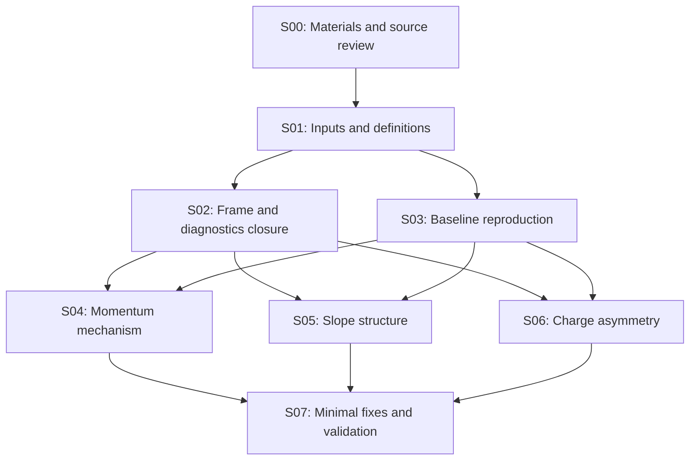

# 几何旋转后的 tracking 研究路线图

本研究要给出三个可复核的答案：动量低估首次出现在哪个运算或候选选择环节、角度分布的剩余结构来自物理混合还是实现问题、μ− 比 μ+ 更易误判电荷的差异在旋转后是否存在及其来源。完成标准包括事件级因果证据、总体发生率及其统计区间、最小修复或经验证的物理解释，以及独立样本回归。

研究起点为本地旋转版 Calypso `88c457c1e4bf4154e67b96114ee8e7020d9b1a97`。本次阶段 00 完成材料与源码研究；下表其余阶段是待执行任务，当前发生率、峰显著性和根因均未测量。

## 阅读与执行入口

| 文档 | 内容 |
| --- | --- |
| [00 材料与源码](00_materials_and_source.md) | PDF 页码、历史数值、输入样本、源码检查点及尚缺信息 |
| [01 公共协议](01_common_protocol.md) | frame/units/truth、运行矩阵、诊断数据、统计与 HTCondor |
| [02 动量研究](02_momentum_bias.md) | segment→seed→CKF→conversion→refit→output 的逐环节审计与消融 |
| [03 角度研究](03_slope_structure.md) | 物理方向恢复、峰的量化、条件分布与数值稳定性检查 |
| [04 电荷研究](04_charge_misidentification.md) | Alma 9 复现、配对比较、谱匹配、符号首次翻转与对称性实验 |

## 目前证据决定的优先级

1. **先核对测量定义与诊断归属。** 当前 per-layer writer 的 truth 动量大小来自 HepMC 链接；当前 Ntuple 直接写出旋转 frame 的动量，VetoNu 角度仍按旧分量比计算；seed→track 的 `trackGroup` 赋值也存在源码可见的索引问题。它们分别影响“动量低估”“角度峰”和“首次变化”的解释，详见材料文档。
2. **为每条输出 track 建立完整来源。** 现有 CKF states 不包含最终 refit 的全部过程；必须保存候选选择前后、ACTS↔Trk 转换、refit 成败与 fallback，并记录 forward/backward、IFT 和合并来源。
3. **分别解释 seed 和 CKF 引入的偏差。** 重现报告中的 good-seed 筛选，同时增加在同一初始 surface 注入 truth 参数与固定 truth hits 的实验。两种实验回答不同问题。
4. **分离几何旋转与参数调优。** 旋转提交也改变了初始 covariance。先建立完整且一致的旋转对照，再把纯 frame 效应、covariance、measurement error、材料和选择效应分开。
5. **三分支共享异常事件与统计母样本。** 对 `momentum tail × slope peak × wrong charge` 交集分别定位；既允许公共根因，也允许独立原因。

## 阶段、依赖与验收

各阶段规模为预算起点，按有效 truth 粒子数、误判数和测量精度调整。凡达到批量规模的 reconstruction/simulation/扫描均走 HTCondor；交互节点只做少量事件与配置调试。

| 阶段 | 依赖与问题 | 实施与起始规模 | 必交付结果与验收 |
| --- | --- | --- | --- |
| S00 材料研究 | 输入报告与本地软件 | 阅读 3 份 PDF，检查源码、样本路径与现成构建 | 本路线图、补全 AGENTS、中文 workbook；已完成，验证见阶段报告 |
| S01 输入与定义冻结 | S00；历史图究竟比较了什么 | 逐类读一个文件的 metadata/schema；每类 10–100 事件检查完整性；冻结 Good Track、fiducial、frame、units、truth surface | 输入 manifest、可运行诊断配置、统一字段字典；所有事件计数闭合；truth 不可得的字段明确列出并落实补充方案 |
| S02 旋转与诊断闭合 | S01；观察量与 frame 是否可靠 | 固定正常与异常事件，校验 surface/field/material/units/covariance；串行与分块运行；诊断开关配对 | frame 与单位闭合、诊断前后行为一致、event/seed/candidate/state 来源唯一；有问题先保留原版基线再修复 |
| S03 原版复现与基线 | S01；与 S02 可交错做原始量检查 | 100044、100116、100117、110033、110051；pilot 约每类 10k 事件，完整 states 只留小子样本 | 紧凑重建表、原始及修正定义的图、cutflow、失败率；复现差异能归到样本/条件/代码或记录具体未解项 |
| S04 动量因果定位 | S02–S03 | [动量实验 M1–M6](02_momentum_bias.md)，先几十条代表 track，再按机制扩展到独立批量验证 | 每个主要 tail 类别的首次数值变化/候选替换、消融效果及区间；seed 与后续 CKF 问题分别闭环 |
| S05 角度结构定位 | S02–S03；共享 S04 的误差与材料观察 | [角度实验 A1–A5](03_slope_structure.md)，truth 谱与 detector/hit pattern 条件分解 | 峰位置、宽度、占比、稳定性和对应物理/程序来源；剩余结构在 forward model 中可复现或被最小修复消除 |
| S06 电荷与正负差异 | S02–S03；共享 S04 的 curvature trace | [电荷实验 Q1–Q5](04_charge_misidentification.md)；先 pilot，再扩至每电荷至少约 100k 有效选中粒子或所需精度 | before/after 配对表、误判率/效率/差值区间、谱匹配结果、首次符号翻转与解释；无显著差异时给可排除范围 |
| S07 修复与独立验收 | S04–S06 各分支形成可检验解释 | 每次一个修改；保留未调参文件作验证；覆盖 μ±、A′ 两样本、forward/backward、3/4 station | 物理指标、效率、失败率与资源回归；中文最终报告、配置、最小 patch、测试和各阶段 commits |

S04、S05、S06 在公共定义与诊断闭合后可以独立推进，结果互相反馈。某一分支暂未找到原因时，记录具体未解类别并继续其他分支；少量离群事件不足以否定整条研究路线。

## 结论成立所需的证据

| 结论类型 | 所需证据 |
| --- | --- |
| 程序缺陷导致某类异常 | 固定输入与候选，在明确函数/更新前后复现偏差；最小修改恢复期望关系；独立事件上对应异常率下降且效率与失败率可解释 |
| 材料、能损或谱混合解释结构 | 使用同一位置的 truth、匹配的输入谱和完整选择，forward simulation/transport 能量化重现结构；关闭相应效应的诊断实验按预期改变结果 |
| 旋转后电荷差异仍存在 | μ± 在共同支持域内的误判率差区间及分箱趋势；同一事件 before/after 的配对比较；重建效率与选择迁移一并给出 |
| 在目标精度内未见问题 | 预先定义指标、区间与等效性范围；给剩余效应的上限或可排除范围；不能用“没有显著性”代替“完全不存在” |

最终比较至少提供 `f(p_reco/p_truth<0.5)`、momentum core median/68% width、angle residual/peak fraction、μ± charge misID、truth reconstruction efficiency、duplicates/fakes、refit failure/fallback 及 CPU/I/O。主效应按事件聚类估计不确定度；逐层与多候选记录不作为独立统计样本。

## 首轮落地任务

1. 在 `configs/` 固定五类输入的具体 RDO/PHYS 文件、event range、生产 geometry/conditions，并补齐历史 Good Track 和原始绘图配置。
2. 在 `scripts/` 与 `configs/` 实现一个可记录普通 CKF 及 refit 的小型入口，显式选择 3-station forward 起始配置，再扩展其余模式；记录原版中默认 masked IFT layers 的实际值。
3. 先完成 Ntuple frame、per-layer truth 来源、seed ID 与 conversion/covariance 的少量事件闭合，再开展尾部、峰形和误判率的批量测量。
4. 依据 pilot 实测的运行时间、内存、有效事件率和输出大小选择 HTCondor 资源；提交前实时比较 schedd 负载。

每阶段先写 `workbook/YYYY-MM-DD_stageNN_topic.md`，列明事实、假设、配置、统计和产物路径，再提交代码/配置与报告。根因检验使用预先保留的验证事件，最终不以在调参样本上得到更好看的直方图作为验收。
