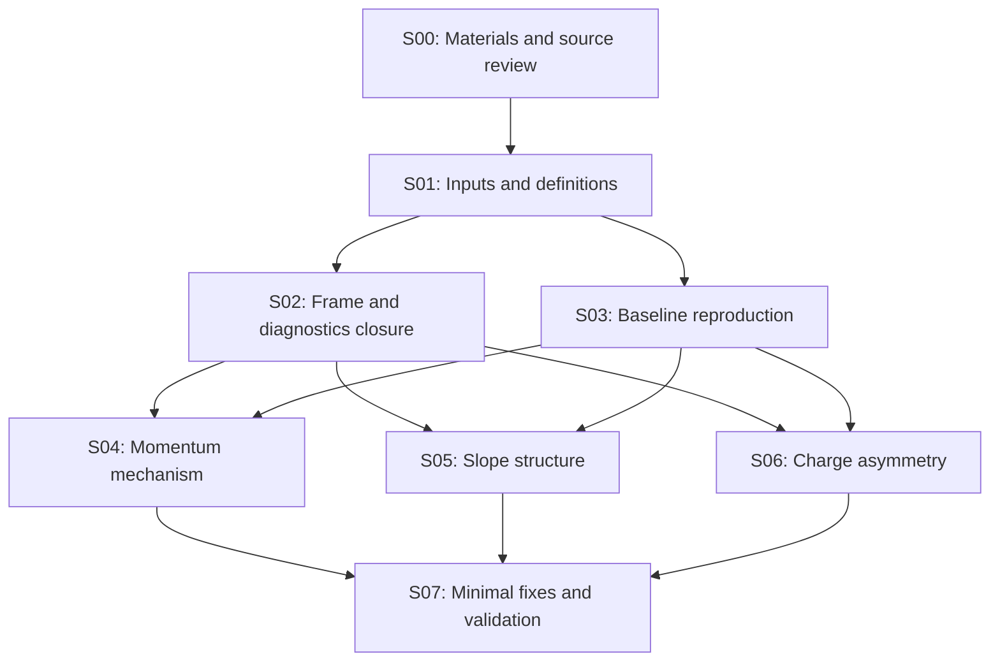

# 几何旋转后的 tracking 研究路线图

本研究要给出三个可复核的答案：动量低估首次出现在哪个运算或候选选择环节、角度分布的剩余结构来自物理混合还是实现问题、μ− 比 μ+ 更易误判电荷的差异在旋转后是否存在及其来源。完成标准包括事件级因果证据、总体发生率及其统计区间、最小修复或经验证的物理解释，以及独立样本回归。

研究起点为本地旋转版 Calypso `88c457c1e4bf4154e67b96114ee8e7020d9b1a97`。S00 材料、S01 输入/定义、S02 旋转与诊断检查、S03 的 50,000 事件基线已完成。五类样本各 10,000 事件，50/50 shards 成功且归档复算一致；峰显著性和总体根因由 S04–S06 检验。

当前实测入口：[S01](../workbook/2026-11-11_stage01_inputs_and_definitions.md)、[S02](../workbook/2026-11-11_stage02_rotation_and_audit_closure.md)、[S03](../workbook/2026-11-11_stage03_baseline.md)。S02 发现 plane/curvilinear covariance chart 和 refit 起点问题，交付默认关闭的实验修正；当前 default material 的 22 surfaces 与历史 rotated map 的 12 surfaces 分开控制。S03 的 10 事件材料配对已显示候选/电荷会变化，总体影响待批量验证。补充 G4 模拟的退出故障记录于 S01，当前 RDO 基线使用 production truth，同 sensor 精确动量尚未测量。

| DSID | Good95 匹配粒子 | production p ratio <0.5 / % | charge misID / % |
| --- | --- | --- | --- |
| 100044 | 6965 | 11.357 | 5.298 |
| 100116 μ+ | 4868 | 1.541 | 0.103 |
| 100117 μ− | 5047 | 2.180 | 0.674 |
| 110033 | 12325 | 12.252 | 2.150 |
| 110051 | 12460 | 33.563 | 13.604 |

以上使用 fiducial+H18、SDO purity≥0.7、Good95；完整 cutflow、区间与匹配歧义检查见 S03。μ−−μ+ 总误判率差为 0.571 个百分点，bootstrap95 为 [0.333,0.829] 个百分点；输入谱不同，尚未隔离算法的电荷不对称或旋转净效应。角度的物理定义已恢复，剩余峰的显著性未测量。

## 阅读与执行入口

| 文档 | 内容 |
| --- | --- |
| [00 材料与源码](00_materials_and_source.md) | PDF 页码、历史数值、输入样本、源码检查点及尚缺信息 |
| [01 公共协议](01_common_protocol.md) | frame/units/truth、运行矩阵、诊断数据、统计与 HTCondor |
| [02 动量研究](02_momentum_bias.md) | segment→seed→CKF→conversion→refit→output 的逐环节审计与消融 |
| [03 角度研究](03_slope_structure.md) | 物理方向恢复、峰的量化、条件分布与数值稳定性检查 |
| [04 电荷研究](04_charge_misidentification.md) | Alma 9 复现、配对比较、谱匹配、符号首次翻转与对称性实验 |

## 目前证据决定的优先级

1. **按最终候选路径定位具体更新。** S02–S03 已建立独立 seed/candidate lineage。100044 的 791 条最终 tail 中，33/726/32 条在 seed/found/refit 首次已观测到低比值；110051 对应 2065/2014/103。用已选出的 32 条无匹配歧义代表 track 重放完整 states，补齐 CKF 与 refit 的 predicted/filtered/smoothed、候选选择和 fallback。首次观测阶段仍需通过逐运算证据才能归因。
2. **把已知接口问题和材料配置分别做配对消融。** 原版基线已保存，下一轮单独启用 chart Jacobian、同点 refit plane、严格旋转 current22 material；先固定候选，再放开排序，量化 tail/misID/效率的共同变化。历史 rotated12 map 同时改变表面内容，不能独自代表纯旋转控制。
3. **分别解释 seed 与后续 CKF。** 重现报告 good-seed 筛选，执行同 surface truth 参数注入与固定 truth hits 两种实验。局部 p truth 需先解决补充 G4 的退出134；已有 production p ratio 包含真实能损，不能直接当作拟合误差。
4. **优先拆分角度选择迁移与 μ± 输入谱。** physical 与 legacy 分量公式相差很大，且 110051 的 reco-p/truth-p 50–250GeV 窗口分别选中3374/1401粒子；先统一物理面再检验多峰。μ− 的34条wrong中30/4条首次在found/refit，优先追踪符号更新，并比较共同 truth p/位置/方向支持域。
5. **建立一致旋转控制并扩展模式。** 当前只完成 3-station forward；完整 G0/G1、backward、4-station 与 merge 后续验证。三分支共享 `momentum tail × slope peak × wrong charge` 母样本，保留独立验证文件，分别报告公共和独立机制。

## 阶段、依赖与验收

各阶段规模为预算起点，按有效 truth 粒子数、误判数和测量精度调整。凡达到批量规模的 reconstruction/simulation/扫描均走 HTCondor；交互节点只做少量事件与配置调试。

| 阶段 | 依赖与问题 | 实施与起始规模 | 必交付结果与验收 |
| --- | --- | --- | --- |
| S00 材料研究 | 输入报告与本地软件 | 阅读 3 份 PDF，检查源码、样本路径与现成构建 | 本路线图、补全 AGENTS、中文 workbook；已完成，验证见阶段报告 |
| S01 输入与定义冻结 | S00；历史图究竟比较了什么 | 已完成 metadata/schema 与每类10事件检查，冻结 Good Track、fiducial、frame、units、truth surface | manifest、诊断入口和字段字典已交付，50事件计数闭合；局部truth记录已写出，补充G4退出134仍待查，见S01报告 |
| S02 旋转与诊断闭合 | S01；观察量与 frame 是否可靠 | 已完成 sensor/field/material/transport/interface 与观察开关配对；保留原版并提供默认关闭的实验修正 | 来源唯一、观察开关前后输出一致；chart/refit问题与material差异已量化，见S02报告；总体物理影响留待S04–S06 |
| S03 原版复现与基线 | S01；与 S02 可交错做原始量检查 | 已完成五类各10k事件，50/50 shards exit0；紧凑审计归档后完整复算 | particle表、图、cutflow、区间、32条代表track与资源已交付，见S03报告；历史selection未恢复、同面truth与完整G0未测量均已记录 |
| S04 动量因果定位 | S02–S03 | [动量实验 M1–M6](02_momentum_bias.md)，先几十条代表 track，再按机制扩展到独立批量验证 | 每个主要 tail 类别的首次数值变化/候选替换、消融效果及区间；seed 与后续 CKF 问题分别闭环 |
| S05 角度结构定位 | S02–S03；共享 S04 的误差与材料观察 | [角度实验 A1–A5](03_slope_structure.md)，truth 谱与 detector/hit pattern 条件分解 | 峰位置、宽度、占比、稳定性和对应物理/程序来源；剩余结构在 forward model 中可复现或被最小修复消除 |
| S06 电荷与正负差异 | S02–S03；共享 S04 的 curvature trace | [电荷实验 Q1–Q5](04_charge_misidentification.md)；先 pilot，再扩至每电荷至少约 100k 有效选中粒子或所需精度 | before/after 配对表、误判率/效率/差值区间、谱匹配结果、首次符号翻转与解释；无显著差异时给可排除范围 |
| S07 修复与独立验收 | S04–S06 各分支形成可检验解释 | 每次一个修改；保留未调参文件作验证；覆盖 μ±、A′ 两样本、forward/backward、3/4 station | 物理指标、效率、失败率与资源回归；中文最终报告、配置、最小 patch、测试和各阶段 commits |

S04、S05、S06 在公共定义与诊断闭合后可以独立推进，结果互相反馈。某一分支暂未找到原因时，记录具体未解类别并继续其他分支；少量离群事件不足以否定整条研究路线。

## 结论成立所需的证据

| 结论类型 | 所需证据 |
| --- | --- |
| 程序缺陷导致某类异常 | 固定输入与候选，在明确函数/更新前后复现偏差；最小修改恢复期望关系；独立事件上对应异常率下降且效率与失败率可解释 |
| 材料、能损或谱混合解释结构 | 使用同一位置的 truth、匹配的输入谱和完整选择，forward simulation/transport 能量化重现结构；关闭相应效应的诊断实验按预期改变结果 |
| 旋转后电荷差异仍存在 | μ± 在共同支持域内的误判率差区间及分箱趋势；同一事件 before/after 的配对比较；重建效率与选择迁移一并给出 |
| 在目标精度内未见问题 | 预先定义指标、区间与等效性范围；给剩余效应的上限或可排除范围；不能用“没有显著性”代替“完全不存在” |

最终比较至少提供 `f(p_reco/p_truth<0.5)`、momentum core median/68% width、angle residual/peak fraction、μ± charge misID、truth reconstruction efficiency、duplicates/fakes、refit failure/fallback 及 CPU/I/O。主效应按事件聚类估计不确定度；逐层与多候选记录不作为独立统计样本。

## 下一轮落地任务

1. 使用 S03 的 `representative_cases.json` 按 file_index/source_entry 重放，选择器已排除 final matching ambiguity；保存首个异常更新与前后候选，不能用复用的生产 event ID 合并事件。
2. 用同一批输入分别检验 current22 严格旋转材料、chart Jacobian、refit plane；恢复历史 Good Track/Twiki 配置后再核对 Alma 数字，完整 G0 对照需保持物理先验一致。
3. 角度统一到 st1/VetoNu plane；μ± 以 truth p/位置/方向做共同支持域与谱平衡。先报告平衡前后发生率和有效样本量，再决定追加批量规模。
4. 解决补充 G4 正常结束问题，生成同 sensor p；新批量按 S03 实测 CPU/RSS/I/O 配置资源，提交前重新比较 schedd 负载。

每阶段先写 `workbook/YYYY-MM-DD_stageNN_topic.md`，列明事实、假设、配置、统计和产物路径，再提交代码/配置与报告。根因检验使用预先保留的验证事件，最终不以在调参样本上得到更好看的直方图作为验收。
