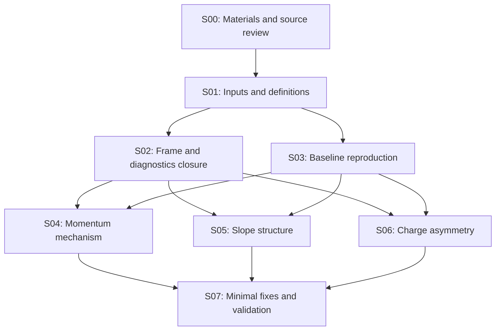

# 几何旋转后的 tracking 研究路线图

本研究要给出三个可复核的答案：动量低估首次出现在哪个运算或候选选择环节、角度分布的剩余结构来自物理混合还是实现问题、μ− 比 μ+ 更易误判电荷的差异在旋转后是否存在及其来源。完成标准包括事件级因果证据、总体发生率及其统计区间、最小修复或经验证的物理解释，以及独立样本回归。

研究起点为本地旋转版Calypso `88c457c1e4bf4154e67b96114ee8e7020d9b1a97`。S00–S05已交付：S03建立五类各10k事件的原版基线，S04完成动量逐运算研究、独立50k母事件的材料配对验证及Calypso内T0–T4控制，S05完成角度主要结构来源、独立控制及限定窗口余量。此前独立ACTS toy退出验收，T5在Calypso实际几何/组件内的完整统计closure未测量，列入S07；[源码与软件来源](../workbook/2026-11-12_stage04_calypso_provenance.md)列明实际路径与patch。

实测入口：[S01](../workbook/2026-11-11_stage01_inputs_and_definitions.md)、[S02](../workbook/2026-11-11_stage02_rotation_and_audit_closure.md)、[S03](../workbook/2026-11-11_stage03_baseline.md)、[S04](../workbook/2026-11-12_stage04_momentum.md)。S04证实current22材料与旋转几何的坐标不一致，主要通过scattering covariance/gain制造大负尾；严格旋转同一map后，独立110051尾率从34.151%降至10.543%，Good95效率提高4.018个百分点。接口chart/refit起点问题、seed混合和辐射后KF残余分别保留受控实验入口。补充G4退出134已定位修复，同sensor truth关联通过2400事件、81153 steps逐值验证。

110051的S04材料对照见[全20文件专项报告](../workbook/2026-11-12_stage04_full110051_pfs.md)：20,000源事件，材料坐标修正前后final尾率33.858%→10.577%。该报告使用S04 Good95/SDO选择，补齐原10文件逐层图，给出predicted/filtered/smoothed的信息范围、同state尾部迁移与曲率不确定度；这些图不代表整体坐标旋转beforeGeo/afterGeo，也不能代替GitHub原宏的复现。

用户指定的[原宏与整体geometry复核](../workbook/2026-11-12_stage04_native_geometry_truth.md)使用110051全20文件、20,000源事件、原生Calypso master/geoRotation及GitHub原宏cuts。afterGeo的566,369个共同有效states上，两种truth的27图逐bin相同；production仅新增约1.02%的truth覆盖，解释不了旧图的大幅结构差异。AFS/strict材料及历史mask012/4station另作控制。产物目录`stage05_geometry_comparison/`属于S04复核；S05角度产物另存`stage05_slopes/`。

[smoothed鼓包来源复核](../workbook/2026-11-12_stage04_smoothing_bump_cause.md)进一步固定旧图的前10文件、10,000事件、strict材料及候选：仅隔离重算smoothing就使S1 L0的residual<−0.8从24.38%降至3.95%，P/F逐值不变；S3 L2的smoothed q/p全部不变，该层主要随SDO purity/final选择减少尾部。旧图右列27个直方图已精确复现；此结果解释逐层states读出，不能当作最终动量修复。

下表保留S03的current22历史基线；strict与独立样本的完整配对表见S04。

| DSID | Good95 匹配粒子 | production p ratio <0.5 / % | charge misID / % |
| --- | --- | --- | --- |
| 100044 | 6965 | 11.357 | 5.298 |
| 100116 μ+ | 4868 | 1.541 | 0.103 |
| 100117 μ− | 5047 | 2.180 | 0.674 |
| 110033 | 12325 | 12.252 | 2.150 |
| 110051 | 12460 | 33.563 | 13.604 |

以上使用 fiducial+H18、SDO purity≥0.7、Good95；完整 cutflow、区间与匹配歧义检查见 S03。μ−−μ+ 总误判率差为 0.571 个百分点，bootstrap95 为 [0.333,0.829] 个百分点；输入谱不同，尚未隔离算法的电荷不对称或旋转净效应。

S05成因定位及A1–A5交付已完成，见[最终结论](../workbook/2026-11-13_stage05_angle_structure_conclusions.md)、[完整实验记录](../workbook/2026-11-12_stage05_slope_structure.md)和[逐项审计](../workbook/2026-11-12_stage05_acceptance.md)。100044每版500k全量完成；beforeGeo额外近零结构来自near-pole方向参数化下的refit update/smoothing。联合regular chart控制在RDO近零109→61（truth58），独立μ+1299→765（truth783）、μ−1321→753（truth749），固定native及same-hit对照均改善，所列窗口剩余差与0相容；角误差核心和大尾同时改善。afterGeo两肩有独立40k strip控制及预留样本response证据，固定窗口保守正过量余量0.4504%/0.6048%；VetoNu宽度主要与靶散射及1/p标度相符。[290页统一图集及来源索引](/eos/home-x/xcheng/FASER/geoRotation_test_results/stage05_slopes/final_report_v1/results/index.md)已逐页核对；独立gun效率下降约2个百分点、pull未校准，正式生产修复留待新输入验收。

## 阅读与执行入口

| 文档 | 内容 |
| --- | --- |
| [00 材料与源码](00_materials_and_source.md) | PDF 页码、历史数值、输入样本、源码检查点及尚缺信息 |
| [01 公共协议](01_common_protocol.md) | frame/units/truth、运行矩阵、诊断数据、统计与 HTCondor |
| [02 动量研究](02_momentum_bias.md) | segment→seed→CKF→conversion→refit→output 的逐环节审计与消融 |
| [03 角度研究](03_slope_structure.md) | 物理方向恢复、峰的量化、条件分布与数值稳定性检查 |
| [04 电荷研究](04_charge_misidentification.md) | Alma 9 复现、配对比较、谱匹配、符号首次翻转与对称性实验 |
| [05 参考图与汇报产物](05_reference_figures.md) | 参考PDF页码到各阶段图清单、共同绘图规范、PNG/PDF与阶段完成标准 |

## 目前证据决定的优先级

0. **以已完成的原宏对照为入口，分离局部bias与production-relative能损。** `t_eQOP`与相同majority barcode的production p实测一致；历史图继续保留`t_eQOP`，逐层算法检验使用同面G4 p。beforeGeo/afterGeo的原生covariance不同，后续固定物理先验及共同seed/hits，才能判断旋转、covariance和选择各自的贡献。AFS/strict有小的产额差异，其navigation/candidate来源尚未定位；file0的三个mask控制27图相同。
   原生共享smoothed slots与候选隔离重算分开呈现，truth purity分组保留共同母样本；两者对旧图形状的作用已定量，按鼓包复核报告使用各自适用的states。
1. **S05成因定位与生产修复分别验收。** 整体beforeGeo/afterGeo的统一物理面、near-pole联合chart、独立μ± full-G4、after肩峰strip/response余量及A′拓扑均已测量。后续S07在新保留输入上检查chart补丁的全量效率与pull校准；固定输入的成因改善不代替生产验收。同面truth model与实际G4真值继续分别标注。
2. **S06先平衡谱与接受度。** 独立strict样本μ+、μ−各剩1条wrong；事件数尚不足以判定残余正负差异。先比较共同truth p/位置/方向支持域与有效样本量，再按目标精度追加。材料配对不代替完整G0/G1的旋转净效应。
3. **S07逐项处理seed和辐射模型。** 110051 strict有3020条最终祖先seed tail，其中2346条含other-majority segment。固定真hits的电子仍有23条guaranteed local tail，11条在update、12条在smoothing出现同sensor可证实的穿越，并有显著沿程能损。使用纯segment组合/同点方向与field integral、G4 bremsstrahlung控制及piecewise q/p/GSF分别检验。
4. **保留接口、pruning与IFT实验。** S04全量100k观察配对的final p/charge/Good95均一致，少量rmax改变；转换mean闭合不代表covariance已修复。4-station finding会使用IFT，但既有refit将IFT判outlier；完整四站refit须显式控制该策略。候选pruning损失也有独立计数。
5. **验证使用新的保留输入。** S04的独立50k已用于材料验收，后续修复使用新的文件/ranges或随机种子；分别报告效率、fakes、failure、angle和charge。历史truth界待定的类别继续保留发生率和输入定位。

## 阶段、依赖与验收

各阶段规模为预算起点，按有效 truth 粒子数、误判数和测量精度调整。凡达到批量规模的 reconstruction/simulation/扫描均走 HTCondor；交互节点只做少量事件与配置调试。

| 阶段 | 依赖与问题 | 实施与起始规模 | 必交付结果与验收 |
| --- | --- | --- | --- |
| S00 材料研究 | 输入报告与本地软件 | 阅读 3 份 PDF，检查源码、样本路径与现成构建 | 本路线图、补全 AGENTS、中文 workbook；已完成，验证见阶段报告 |
| S01 输入与定义冻结 | S00；历史图究竟比较了什么 | 已完成 metadata/schema 与每类10事件检查，冻结 Good Track、fiducial、frame、units、truth surface | manifest、诊断入口和字段字典已交付，50事件计数闭合，见S01报告；当时的补充G4退出134已在S04修复并验证 |
| S02 旋转与诊断闭合 | S01；观察量与 frame 是否可靠 | 已完成 sensor/field/material/transport/interface 与观察开关配对；保留原版并提供默认关闭的实验修正 | 来源唯一、观察开关前后输出一致；chart/refit问题与material差异已量化，见S02报告；总体物理影响留待S04–S06 |
| S03 原版复现与基线 | S01；与 S02 可交错做原始量检查 | 已完成五类各10k事件，50/50 shards exit0；紧凑审计归档后完整复算 | particle表、图、cutflow、区间、32条代表track与资源已交付，见S03报告；历史selection未恢复、同面truth与完整G0未测量均已记录 |
| S04 动量因果定位 | S02–S03 | current/strict全量逐层、Calypso内T0–T4、独立50k配对、backward/4-station/真实merge已完成；T5完整Calypso统计closure列入S07 | 材料主因与独立改善、seed类别和23条电子local tail运算证据、完整剩余类/资源/测试；[S04报告](../workbook/2026-11-12_stage04_momentum.md) |
| S05 角度结构定位 | S02–S03；共享 S04 的误差与材料观察 | [角度实验 A1–A5](03_slope_structure.md)，完整500k/版、固定候选最小控制与独立full-G4 | 主要来源、固定窗口余量及效率/pull副作用已量化；[最终结论与图集](../workbook/2026-11-13_stage05_angle_structure_conclusions.md)、[A1–A5审计](../workbook/2026-11-12_stage05_acceptance.md)；完整生产修复另在S07验收 |
| S06 电荷与正负差异 | S02–S03；共享 S04 的 curvature trace | [电荷实验 Q1–Q5](04_charge_misidentification.md)；先 pilot，再扩至每电荷至少约 100k 有效选中粒子或所需精度 | before/after 配对表、误判率/效率/差值区间、谱匹配结果、首次符号翻转与解释；无显著差异时给可排除范围 |
| S07 修复与独立验收 | S04–S06 各分支形成可检验解释 | 每次一个修改；保留未调参文件作验证；覆盖μ±、A′两样本、forward/backward、3/4 station；补齐实际Calypso内T5统计closure | 物理指标、效率、失败率与资源回归；中文最终报告、配置、最小patch、测试和各阶段commits |

S04、S05、S06 在公共定义与诊断闭合后可以独立推进，结果互相反馈。某一分支暂未找到原因时，记录具体未解类别并继续其他分支；少量离群事件不足以否定整条研究路线。

## 结论成立所需的证据

| 结论类型 | 所需证据 |
| --- | --- |
| 程序缺陷导致某类异常 | 固定输入与候选，在明确函数/更新前后复现偏差；最小修改恢复期望关系；独立事件上对应异常率下降且效率与失败率可解释 |
| 材料、能损或谱混合解释结构 | 使用同一位置的 truth、匹配的输入谱和完整选择，forward simulation/transport 能量化重现结构；关闭相应效应的诊断实验按预期改变结果 |
| 旋转后电荷差异仍存在 | μ± 在共同支持域内的误判率差区间及分箱趋势；同一事件 before/after 的配对比较；重建效率与选择迁移一并给出 |
| 在目标精度内未见问题 | 预先定义指标、区间与等效性范围；给剩余效应的上限或可排除范围；不能用“没有显著性”代替“完全不存在” |

最终比较至少提供 `f(p_reco/p_truth<0.5)`、momentum core median/68% width、angle residual/peak fraction、μ± charge misID、truth reconstruction efficiency、duplicates/fakes、refit failure/fallback 及 CPU/I/O。主效应按事件聚类估计不确定度；逐层与多候选记录不作为独立统计样本。

每阶段同时交付[参考图清单](05_reference_figures.md)规定的分布图，使用参考材料对应的物理量和面板布局，展示before/after及必要的legacy/正确定义对照。PNG、逐图PDF、完整汇报PDF和bin counts写入results，主图嵌入workbook并链接图集。

## 下一轮落地任务

0. 按[原宏复核报告](../workbook/2026-11-12_stage04_native_geometry_truth.md)保留历史图与truth对照；动量后续控制固定物理先验及共同seed/hits，使用同面G4 truth区分实际能损与KF bias。AFS/strict小产额差异保留导航与candidate排查，不将其当作已定位原因。
1. S05按已测来源表保留原生基线、联合chart及独立验证入口；后续比较使用相同physical surface、native固定候选和same-hit子组，继续同时报告效率、残差大尾、pull及窗口余量。完整图表与冻结证据见S05最终结论报告。
2. S06使用correct material后的μ±共同支持域，检查首次sign flip与谱平衡后的率差；记录既有样本的精度，再确定追加规模。Alma历史selection与完整G0/G1仍单独控制。
3. S07从已定位的other-segment seed、真实radiative loss后的update/smoothing、chart/refit covariance、IFT策略分别做单因素实验。Gaussian mixture能损的文献可行性和典型事件见S04，未把它当作已验证修复。
4. 所有新批量按S04实测CPU/RSS/I/O配置资源，提交前重新比较兼容schedd；所有源码、数据身份与observer开关继续冻结。

每阶段先写 `workbook/YYYY-MM-DD_stageNN_topic.md`，列明事实、假设、配置、统计和产物路径，再提交代码/配置与报告。根因检验使用预先保留的验证事件，最终不以在调参样本上得到更好看的直方图作为验收。
